<!-- ═══════════════════════ HERO ═══════════════════════ -->
<div align="center">
  
</div>

<br/>

<!-- ═══════════════════════ INTRO ═══════════════════════ -->
<div align="center">

### Olá, eu sou **Eduardo** 👻

**Desenvolvedor Full-Stack em formação** · Front-end · Back-end · UI/UX

Técnico em Desenvolvimento de Sistemas pelo SESI SENAI SC, caminhando para ser um desenvolvedor full-stack.<br/>
Hoje em estudos avançados de React, Node.js e PHP — <i>trying to be better</i>.

<a href="https://portfolio-xi-orcin-59.vercel.app/"></a>

</div>

<br/>

<!-- ═══════════════════════ NAV ═══════════════════════ -->
<div align="center">
  <a href="#projetos"></a>
  <a href="#stack"></a>
  <a href="#andamento"></a>
  <a href="#atividade"></a>
  <a href="#contato"></a>
</div>

<br/><br/>

<!-- ═══════════════════════ 01 · PROJETOS ═══════════════════════ -->
<a name="projetos"></a>


<!-- ── projeto 01 ── -->
<a href="https://github.com/Eduardo-Virissimo/vanish"></a>

Limpa arquivos temporários e caches do Windows, mostrando antes exatamente quais pastas vão sumir.

- ✦ Lista fechada e auditada de pastas
- ✦ Confirmação com avisos antes de apagar
- ✦ Testes que barram pastas perigosas

**Stack:** `Electron` `TypeScript`

<a href="https://github.com/Eduardo-Virissimo/vanish"></a>

<br/>

<!-- ── projeto 02 ── -->
<a href="https://github.com/Eduardo-Virissimo/analyst-sql"></a>

Agente de IA que responde perguntas em português gerando, validando e executando SQL somente leitura no MySQL.

- ✦ Corrige os próprios erros de consulta
- ✦ Taxa de acerto medida

**Stack:** `Next.js` `TypeScript` `MySQL`

<a href="https://github.com/Eduardo-Virissimo/analyst-sql"></a>

<br/>

<!-- ── projeto 03 ── -->
<a href="https://github.com/Eduardo-Virissimo/PrintScream"></a>

Gera PDFs de páginas web a partir de uma URL usando Puppeteer.

**Stack:** `TypeScript` `Puppeteer`

<a href="https://github.com/Eduardo-Virissimo/PrintScream"></a>

<br/><br/>

<!-- ═══════════════════════ 02 · STACK ═══════════════════════ -->
<a name="stack"></a>


<table align="center" width="100%">
  <tr>
    <td width="25%" align="center" valign="top">
      
      <br/>
      
      <br/>
      
    </td>
    <td width="50%" align="center" valign="top">
      
      <br/>
      
    </td>
    <td width="25%" align="center" valign="top">
      
      <br/>
      
      <br/>
      
    </td>
  </tr>
</table>

<table width="100%">
  <tr>
    <td width="33%" valign="top">
      <b>✦ Front-end</b><br/><br/>
      
      
      
      
      
      
      <br/><sub>Interfaces responsivas, componentes e design system.</sub>
    </td>
    <td width="33%" valign="top">
      <b>✦ Back-end</b><br/><br/>
      
      
      
      <br/><sub>APIs REST, autenticação e modelagem de dados.</sub>
    </td>
    <td width="33%" valign="top">
      <b>✦ Tools &amp; Infra</b><br/><br/>
      
      
      
      
      
      
      <br/><sub>Versionamento, containers, deploy e prototipação.</sub>
    </td>
  </tr>
</table>

<details>
<summary><b>como eu leio meus níveis</b></summary>
<br/>

| marca | significado |
|:---:|---|
| ● | uso no dia a dia, com confiança |
| ✦ | estudos avançados, já usei em projeto |
| ○ | explorando / primeiros passos |

</details>

<br/><br/>

<!-- ═══════════════════════ 03 · EM ANDAMENTO ═══════════════════════ -->
<a name="andamento"></a>


```
~/now
├── vanish ............ limpeza segura de temporários do Windows
├── analyst-sql ....... agente de IA que gera e valida SQL
├── estudos ........... React · Node.js · PHP (advanced studies)
└── formação .......... Téc. em Desenvolvimento de Sistemas · SESI SENAI SC
```

<br/>

<!-- ═══════════════════════ 04 · ATIVIDADE ═══════════════════════ -->
<a name="atividade"></a>


<div align="center">
  
  
  <br/>
  
  <br/>
  <a href="https://github.com/Eduardo-Virissimo?tab=repositories"></a>
</div>

<br/>

<!-- ═══════════════════════ 05 · CONTATO ═══════════════════════ -->
<a name="contato"></a>


<div align="center">
  <a href="https://www.linkedin.com/in/eduardo-teixeira-vir%C3%ADssimo-46471624b/"></a>
  <a href="mailto:eduardoteixeiravirissimo@gmail.com"></a>
  <a href="https://github.com/Eduardo-Virissimo"></a>
  <br/><br/>
  <sub><code>eduardoteixeiravirissimo@gmail.com</code> · <code>@Eduardo-Virissimo</code></sub>
</div>

<br/>

<!-- ═══════════════════════ FOOTER ═══════════════════════ -->

