<!-- ═══════════════════════ HERO ═══════════════════════ -->

  

 

<!-- ═══════════════════════ INTRO ═══════════════════════ -->

### Olá, eu sou **Eduardo** 👻

Técnico em Desenvolvimento de Sistemas pelo SESI SENAI SC, caminhando para ser um desenvolvedor full-stack. 
<i>trying to be better.</i>

 

<!-- ═══════════════════════ NAV ═══════════════════════ -->

  
  
  
  

  

<!-- ═══════════════════════ PROJETOS ═══════════════════════ -->

<!-- ── projeto 01 ── -->

Limpa arquivos temporários e caches do Windows, mostrando antes exatamente quais pastas vão sumir.

- Lista fechada e auditada de pastas
- Confirmação com avisos antes de apagar
- Testes que barram pastas perigosas

 

<!-- ── projeto 02 ── -->

Agente de IA que responde perguntas em português gerando, validando e executando SQL somente leitura no MySQL.

- Corrige os próprios erros de consulta
- Taxa de acerto medida

 

<!-- ── projeto 03 ── -->

Gera PDFs de páginas web a partir de uma URL usando Puppeteer.

  

<!-- ═══════════════════════ STACK ═══════════════════════ -->

  

<!-- ═══════════════════════ ATIVIDADE ═══════════════════════ -->

  

<!-- ═══════════════════════ CONTATO ═══════════════════════ -->

Tem um problema chato? Me chama no LinkedIn.

&nbsp;

 

<!-- ═══════════════════════ FOOTER ═══════════════════════ -->

